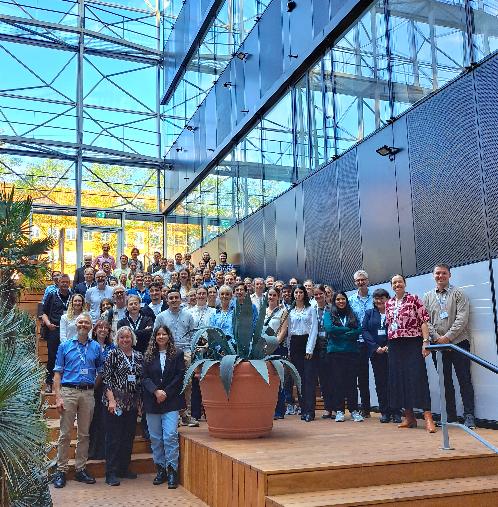
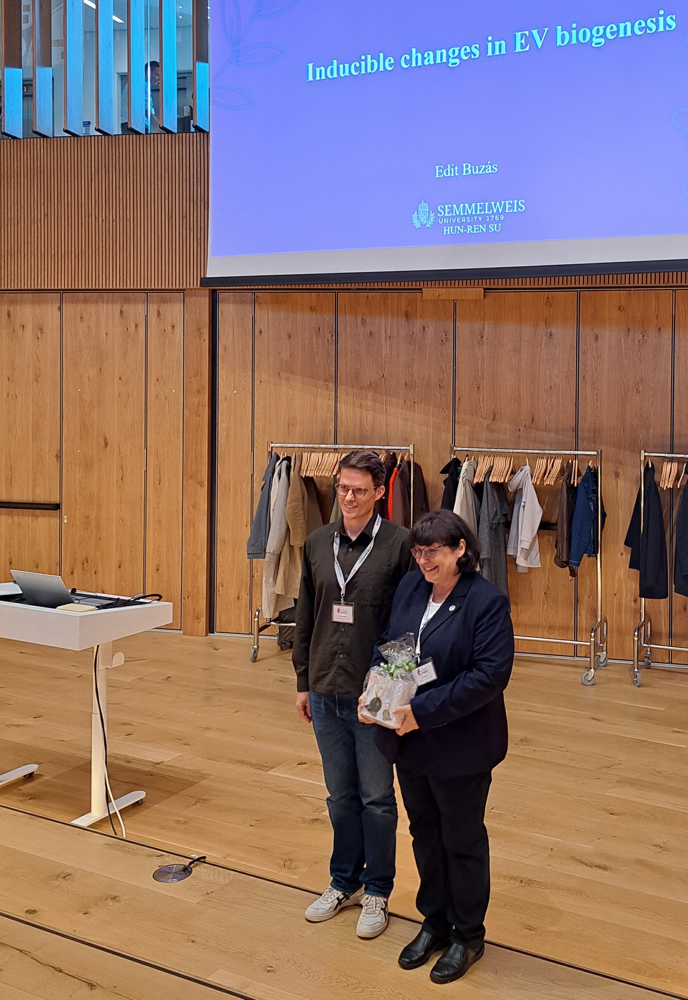
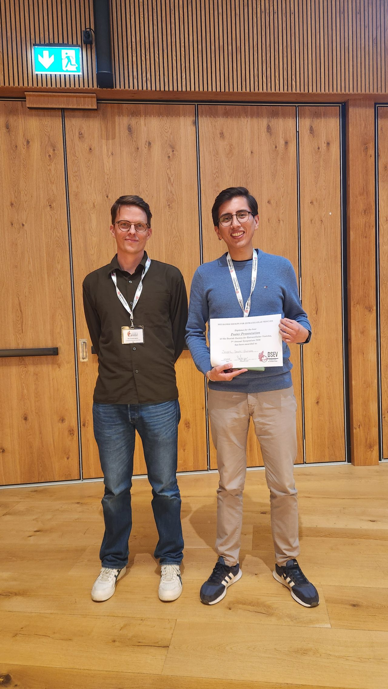
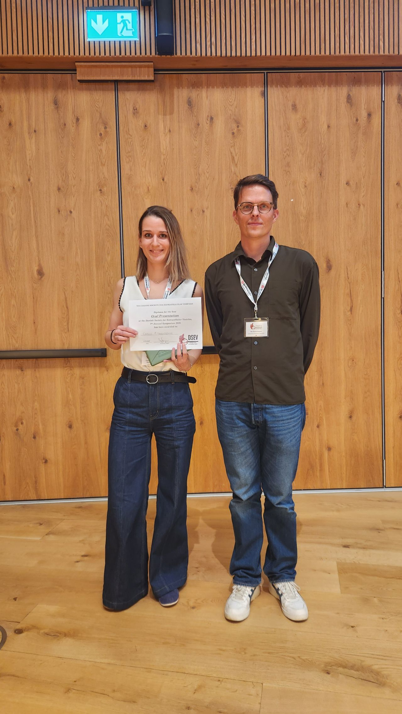
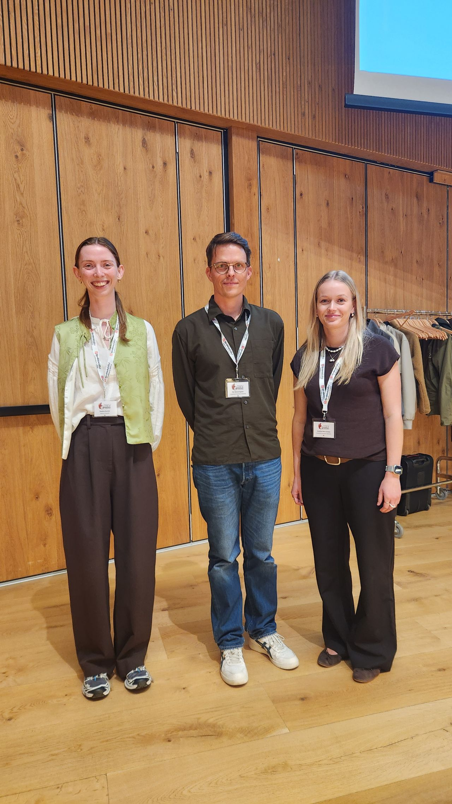

The 7th DSEV Annual Symposium in 2026 was held in Copenhagen. We were delighted to welcome the keynote speaker Edit Buzás from Semmelweis University, Hungary, and 94 participants who together made it a great success! It was an engaging event with scientific contributions from the inspiring keynote lecture, 13 sponsors, 24 posters and 8 short talks. Let's thank again the financial support by the sponsors: AH Diagnostics, AcouSort, BioNordika, Biowest Nordic, CliniSciences, Izon Science, Oleinitec, Ramcon, Secretech Biosciences, Shimadzu, Thermo Fisher Scientific, VWR, and Waters (formerly BD Biosciences)! (listed in alphabetical order)

Thank you for a great meeting - and please mark your calendars for next year's symposium on the 4th of March 2027 in Odense!

(photo: Ole Østergaard)

Group photo

\---

(photo: Ole Østergaard)

**Keynote Speaker (right)**: Edit Buzás; Semmelweis University*, Hungary.*

*"Inducible changes in EV biogenesis"*

*\---*

(photo: Hubert Krzyslak)

**Best poster award (right)**: Javier Donoso-Quezada; *Aalborg University Hospital, Denmark.*

*"Dietary patterns associate with cytokine cargo and inflammatory profiles of circulating extracellular vesicles in obesity-associated MASLD and during weight loss"*

*\---*

(photo: Hubert Krzyslak)

**Best oral presentation award (left)**: Camille Menaceur Vandenbroucke; *Aarhus University, Denmark*.

*"Tracing the Protein Corona Footprint of Extracellular Vesicles Mapped In Situ by EV-SPEC in Cells and Zebrafish"*

*\---*

(photo: Hubert Krzyslak)

**MOVE fellowship (left)**: Sophia Hunter; *PhD student, Aarhus University, Denmark*.

Granted DKK 15.000 for a 3-month research visit to Samir EL Andaloussi’s lab at Karolinska Institute (Stockholm, Sweden).

*"From Zebrafish to Therapeutics: Advancing EV-Based RNA Delivery"*

**MOVE fellowship (right)**: Josefine Bech Jensen; *PhD student, Southern University of Denmark, Denmark*.

Granted DKK 15.000 for a 3-month research visit to Oscar Wiklander’s lab at Karolinska Institute (Stockholm, Sweden).

*"Unraveling the Crosstalk between Tumor-Derived EVs and the TME"*
